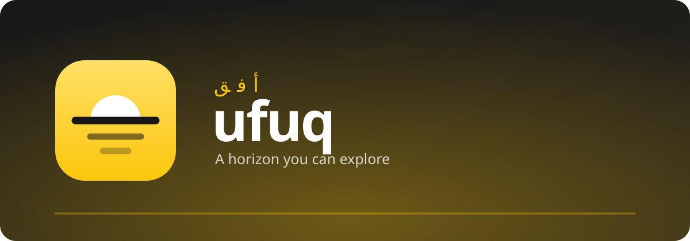

**Ufuq (أفق) turns PDFs into interactive learning experiences.** 🌟

A learner uploads a document. Ufuq understands it, identifies the concepts that matter, teaches each one in a format that fits it, and keeps every explanation grounded in the source pages. The learner explores an interactive experience instead of passively rereading or scanning a summary. 📖

- **🎯 Who it's for:** learners of all ages — welcoming and playful, without looking childish.
- **✨ What it does:** one upload, one interactive experience, ready to explore and revisit.
- **🧭 What makes it different:** the right visual and interaction format for each concept, chosen automatically; grounded in the learner's own document; English and Arabic from day one.
- **🚫 What it is not:** a summarizer, a flashcard or quiz generator, or a chat interface.

---

🚧 **Early stage** — the product is in pre-launch preparation. The name "Ufuq" (أفق, "horizon") is selected, pending trademark, domain, and handle clearance.

---

## Development

The repo is an Nx monorepo using pnpm.

```text
apps/
  web/        Angular app
  web-e2e/    Playwright end-to-end tests
  api/        NestJS API
libs/
  shared/     Zod schema and EN/AR language foundation
  web/        Design system and player components
  eval/       AI evaluation sets and regression runner
```

Common commands:

```bash
pnpm install                 # install dependencies
pnpm nx serve web            # start web (also starts the API)
pnpm nx affected -t lint test typecheck build
pnpm nx e2e web-e2e          # run Playwright tests
```

`shared/schema` is the single source of truth for API contracts. Both apps
validate against it. Nx tags enforce module boundaries: `web` and `api` may only
depend on their own scope and on `scope:shared` libraries.
